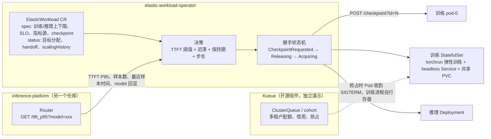

# elastic-workload-operator

一个基于 Go / controller-runtime 的 Kubernetes Operator：根据推理服务的 TTFT P95，在同一份资源预算内调整训练副本和推理副本，并在训练成员变化前先完成 checkpoint 握手。

这里展示核心实现、复现实验与验证证据；实验记录为 2026-10 的项目快照。

> **验证范围先说清楚**：所有端到端结果都来自 **Kind 单节点集群**，训练是 **CPU 上的 PyTorch DDP（gloo）小模型**，推理侧在握手验收中是 busybox 占位容器，TTFT 由 mock Router 人为切换。验证的是**编排协议和恢复语义**，不是 GPU 性能、NCCL 通信或多节点存储。

## 要解决的问题

一个团队有固定的计算资源，一部分跑训练，一部分提供在线推理。白天请求多，推理需要更多副本；夜间请求少，资源应该还给训练。固定各占一半，会出现一边排队、一边空闲。

把这件事落到 Kubernetes 上，会遇到几个具体问题：

1. **分多少**：什么时候把资源从训练让给推理、什么时候归还，依据什么指标，指标不可信时怎么办。
2. **改到一半失败怎么办**：训练和推理是两个对象，不可能原子地一起改。控制器在中间崩溃或 API 写入冲突后，重试不能让总数漂移。
3. **训练缩容怎么不丢进度**：直接删训练 Pod 会丢掉上次存盘之后的进度；Deployment 缩容删哪个 Pod 也不确定。
4. **多个租户之间的配额**：这一层交给 Kueue，本项目不重新实现。

## 架构



三层分工（面试高频，也是本项目的边界）：

| 组件 | 负责什么 | 本项目是否实现 |
|---|---|---|
| Kueue | 工作负载能不能被接纳、配额不够时该抢占谁 | 否，直接使用 Kueue v0.19.9 |
| kube-scheduler | Pod 放到哪个节点 | 否 |
| 本 Operator | 同一租户内训练和推理怎么分副本、怎么握手让渡 | 是 |

**注意**：目前 Operator 和 Kueue **没有集成**。Kueue 演示是用 `config/kueue-demo/` 下的 Job 单独跑的，证明的是「Kueue 抢占 + 训练进程靠 SIGTERM 存盘」能配合，不是「Operator 由 Kueue 管理」。

## 核心设计

### 1. 目标持久化与收敛

- 每次决策先把**完整的目标分配**（训练 N、推理 M）写进 `status`，再去改子资源。
- `apply` 朝**目标值**收敛，而不是叠加**差值**。部分失败后重试时，已经到位的一侧是 no-op，没到位的一侧继续补，总数不会漂移（旧版用 delta 叠加，曾把 6 拖成 5）。
- `cur == target` 时不写，少一次 API 写入，也不覆盖外部改动。Update 带 resourceVersion，冲突时返回错误，由 controller-runtime 退避重试（乐观并发）。
- 保持期的「上次扩缩时间」存在 `status.scalingHistory`，控制器重启后不丢。
- 遇到没有 ownerReference 的同名子资源，拒绝收养。

### 2. 指标校验

决策只在指标可信时进行，否则冻结新决策、只恢复已提交的目标：

- 新鲜度：最近样本不能超过 `--metric-max-age`（默认 30 秒），也不能超前于本地时钟太多（`--metric-clock-tolerance`，默认 5 秒）。
- 样本量：窗口内样本少于 `--metric-min-samples`（默认 20）不做决策。
- 决策规则：TTFT P95 > SLO 时把副本从训练让给推理；TTFT P95 < 0.6 × SLO 时归还。两者之间是迟滞区，不动作。比较用 int64（`ttft*10 < slo*6`），避免 int32 溢出。

### 3. 按 CR 指定指标源，并要求模型回显

- CRD 可选字段 `spec.scalingPolicy.metrics`：`routerURL` 和 `model`。不填就用控制器的默认值，老的 CR 不受影响。
- 每次决策按当前 CR 拼地址：`{routerURL}/ttft_p95?model=xxx`。
- **模型回显校验**：CR 指定了 model 时，Router 返回的 `model` 必须和请求一致，否则报 `MetricModelMismatch` 并冻结决策。原因：老版 Router 会忽略不认识的参数，`?model=B` 照样返回 A 的数据，Operator 会拿错的延迟做决策而且不报错。回显把「静默拿错数据」变成显式错误。
- 已知边界：Router 的窗口按模型隔离，但只是**单个 Router 进程**内的统计。Router 多副本时需要聚合，目前没有做。

### 4. 训练侧：StatefulSet + torchrun 弹性训练

训练进程在 `workloads/trainer/`：

- PyTorch DDP（gloo、CPU），torchrun 弹性启动（`--nnodes=MIN:MAX`、c10d rendezvous）。
- 全局 batch 固定为 840（能被 1～8 整除），每个 rank 分到 840/world，成员数变化时每一步的计算不变。
- 数据按 step 确定性生成（种子 = seed + step），恢复时不需要保存 DataLoader 状态。
- Checkpoint 包含模型、优化器（含 momentum）和 step，先写临时文件再 rename，保证原子性。
- 三种存盘触发：每 200 步定期保存；控制器请求（`POST /checkpoint?id=N`）；有成员收到 SIGTERM。每一步做一次 `all_reduce(MAX)` 同步「请求 id」和「是否有成员要离开」，所有 rank 在同一步决定存盘，由 rank0 写盘。

为什么用 StatefulSet 而不是 Deployment：

- 缩容一定删**序号最大**的 Pod，0 号 Pod 始终保留，所以让 0 号当 rendezvous 主机。Deployment 缩容删哪个 Pod 不确定。
- headless Service 设置 `publishNotReadyAddresses: true`，因为 rendezvous 发生在 Pod Ready 之前。
- `podManagementPolicy: Parallel`，扩容时多个 Pod 并行创建。

推理侧仍然是 Deployment。

### 5. 三阶段握手（`internal/controller/handoff.go`）

状态全部存在 `status.handoff`，控制器重启后从当前阶段继续：

1. **CheckpointRequested**：两边副本保持原样，反复向 0 号 Pod 发 `POST /checkpoint?id=<毫秒时间戳>`，直到返回的 checkpoint_id ≥ 请求的 id。请求是幂等的。超过 `timeoutSeconds`（默认 60 秒）仍未确认，就不存盘直接继续，发 Warning 事件 `CheckpointTimeout`。取舍：推理 SLO 优先于训练进度。
2. **Releasing**：只缩让出资源的一方，并等它的 **Pod 真正消失**（正在终止的 Pod 也算在内）。只看 `spec.replicas` 不够，Terminating 的 Pod 还占着资源。
3. **Acquiring**：扩接收资源的一方，两边都 Available 后清掉 handoff，发 `HandoffCompleted` 事件（带 checkpoint、释放和总耗时）。

补充规则：

- 两个方向都握手：推理扩容时先缩训练再扩推理；归还时先缩推理再扩训练。训练扩容前也要存盘，因为新成员加入同样会触发全员重启。
- 握手期间暂停新决策。提交握手时把完整 spec 保存到 `status.handoff.specSnapshot`；任何 spec 变更都会在修改子资源前冻结交接，报告 `HandoffSpecChanged`，恢复原 spec 后继续，不自动重规划。旧版本进行中的握手会把升级后第一次观察到的 spec 保存为基线，无法追溯升级前的修改。
- `spec.scalingPolicy.handoffTimeoutSeconds` 默认 300 秒，分别约束 Releasing 和 Acquiring 的等待时间。阶段开始时间持久化；超过时间报告 `HandoffStalled=True`、`Degraded` 和一次 Warning 事件，不清除目标、不跳过资源释放、不自动回滚；继续观察并在阻塞解除后自动推进。300 秒是覆盖既有约 110 秒演示的保守初值，不是实测 SLA。CheckpointRequested 仍使用独立的 checkpoint 超时。
- 训练原来是 0 副本时跳过存盘。
- 没配置 `spec.training.checkpoint` 时，行为和旧版一致（两边直接同时改）。

### 6. 与 Kueue 抢占的配合

在 Kind 里装 Kueue v0.19.9，两个租户各一个 ClusterQueue，放在同一个 cohort 里允许互借。被抢占的训练 Pod 收到 SIGTERM，训练进程按上面的规则存盘后退出；重新被接纳后从 checkpoint 继续。这一步用的是 Kueue 自带的抢占能力加训练进程的配合，**不是自研抢占，也没有接入 Operator**。

## 验证证据

| 层次 | 内容 | 结果 | 条件与边界 |
|---|---|---|---|
| 单元 / envtest | `make test`、`go test -race` | **48 个测试函数**全部通过，controller 包语句覆盖率 **87.0%** | 握手测试用 fake client 和本地测试服务器，不跑真实 StatefulSet 控制器 |
| 端到端：推理扩容（训练 2→1） | `scripts/validate_handoff.py` | 握手总耗时 3.6 秒，**训练 0 步丢失**，训练暂停约 22 秒（torchrun 重新组网） | Kind 单节点，CPU 训练，推理为 busybox 占位，TTFT 由 mock 切换 |
| 端到端：归还（训练 1→2） | 同上 | **训练 0 步丢失**，从第 114 步恢复；握手总耗时 1 分 50 秒，其中释放推理 33 秒，训练暂停约 72 秒 | 72 秒的原因见「已知问题」；33 秒是 busybox 不处理 SIGTERM，等满 30 秒宽限期 |
| 真实崩溃 | `scripts/crash_trainer.sh` 对训练 worker 进程发 SIGKILL | 丢失 **90 步**（约 46 秒训练），**5.8 秒**后从上一个定期存盘点恢复 | 计划内变更零丢失，意外崩溃丢「距上次定期存盘的步数」 |
| Kueue 抢占 | `scripts/kueue_demo.py` | 高优先级任务提交后 **1.3 秒**低优先级训练被抢占，训练在**第 102 步**存盘退出；重新接纳后**从第 102 步恢复** | Kind 单节点、单成员 CPU 训练、CPU 配额；不证明 Operator 与 Kueue 集成、多成员训练被抢占、GPU 配额或公平共享 |
| 训练收敛 | events.jsonl | 多次成员变化后，loss 从约 0.12 降到约 0.003（约 19000 步、3.5 小时） | 小 MLP，合成数据 |

端到端条件：Kind 单节点（实验中途用 `docker update` 从 3GiB/2 核调到 5GiB/4 核），2 个训练副本、1～2 个推理副本，全局 batch 840，每 200 步定期存盘。

原始结果在 `docs/experiments/handoff-20261019/` 和 `docs/experiments/kueue-20261019/`。

**测试方法上踩过的坑**：一开始用 `kubectl delete pod --force --grace-period=0` 当「强杀」，结果 kubelet 仍然先发了 SIGTERM，测出「零丢失」是假象。`validate_handoff.py` 里这一步现在叫 `forced_delete_sigterm_recovery`，只代表 SIGTERM 路径；真正的崩溃测试用 `crash_trainer.sh`。

## 已知问题

1. **torchrun 扩容组网竞态（约 72 秒暂停）**：扩容时 pod-0 的 agent 在 `_assign_worker_ranks` 等 role_info，pod-1 在 `RendezvousStoreInfo.build` 等 MASTER_ADDR，双方各自 60 秒 `DistStoreError` 超时后退出，容器重启后第二轮组网才成功。缩容方向没遇到。**未修复**。可能的方向：把 rendezvous store 从 pod-0 移到独立服务（例如 etcd 后端）；扩容时让全体训练进程一起重启；缩短 store 超时。
2. **没有自动回滚**：阶段超时只标记异常并保留现场。配置冲突需要恢复握手快照；资源、镜像拉取、PVC、DNS 或终止异常需要修复对应依赖。坏镜像已经写入握手快照时，不能靠交接中换镜像来绕过保护，应按下面步骤停机重建。
3. **没有自动重规划和无损缩容**：交接中的配置变更会冻结；推理侧没有在途排空握手，不能承诺正在执行的请求不受缩容影响。
4. 其他边界：控制器是单副本；status 中的目标是单对象提交，两个子资源的实际变化不是原子的；Router 指标只来自单个 Router 进程；`prefixCaching=true` 当前报不支持；没有 scale 子资源。

## 快速开始

### 交接异常的恢复步骤

先观察 `status.handoff`、Conditions、Events 和两侧 Pod，确认阶段、checkpoint、Pod 数、Pending/Terminating 原因。不要清空 `status.handoff` 或手动把阶段改成 Acquiring，这会绕过先释放后获取的安全条件。

`HandoffSpecChanged` 时，先审阅 `status.handoff.specSnapshot`，确认愿意恢复原配置，再执行下列 JSON Patch。它检查 checkpointID，避免把旧快照用于另一轮交接；完成后再提交需要的新配置。以下变量必须改为自己的隔离集群和对象，不要对生产执行。

```bash
CONTEXT=kind-ew-recovery-lab
NAMESPACE=ew-validation
WORKLOAD=demo
kubectl --context "$CONTEXT" -n "$NAMESPACE" get elasticworkload "$WORKLOAD" -o json |
  jq -e 'if .status.handoff.specSnapshot == null then error("no handoff snapshot") else [{op:"test",path:"/status/handoff/checkpointID",value:.status.handoff.checkpointID},{op:"replace",path:"/spec",value:.status.handoff.specSnapshot}] end' > /tmp/ew-restore-spec.json
```

仅在上一条成功且人工审阅补丁后执行：

```bash
kubectl --context "$CONTEXT" -n "$NAMESPACE" patch elasticworkload "$WORKLOAD" --type=json --patch-file /tmp/ew-restore-spec.json
```

`HandoffPhaseTimeout` 时先修复外部依赖；控制器继续观察，条件满足后会自动进入下一阶段或完成，不需要手动解除超时标记。若问题只能通过修改 spec 解决，先确认最新 checkpoint、记录 PVC 和现场、接受推理中断，再正常删除 CR，等待其受管 Pod 全部退出后用修正后的清单重建，复用原有独立 PVC。不要强制移除 finalizer，不删除 PVC；删除 CR 本身不会请求额外存盘，不能承诺这条人工重建路径零丢失。

### 2026-10-20 收口验证边界

本轮补充阶段超时、spec 冻结与恢复、重启后继续、旧状态迁移、快照写失败及 CRD schema/defaults 回归。首次受限会话只跑离线子集；切换 full access 后，`make test`、完整 controller race、lint/build/vet 均通过：**55 个顶层测试函数（含 envtest 入口），race 含子用例 102 条，controller 语句覆盖率 87.7%**。旧 48 个函数/87.0% 是历史结果。

新版 `ew-operator:closure-20261020-v2` 已部署隔离 Kind，真实 CPU DDP 的正反向交接均从最近存盘步恢复；从交接前最后存盘到恢复约 19 秒/75 秒。独立故障脚本 `scripts/validate_closure.py` 的 8 项检查通过：三阶段 spec 变更冻结/恢复、释放超时、重启不重置期限、获取超时、解除故障后继续及 Warning 事件。故障脚本使用 checkpoint HTTP 协议桩和 readiness gate，不冒充真实训练；真实训练另由 validate_handoff.py 验证。

真正 SIGKILL worker 的补验恢复到第 200 步，按杀进程前进度速率估算丢失约 55 步（37.2 秒训练量），4.2 秒恢复。修正 crash_trainer.sh 的 heredoc 临时路径和超时失败退出，使用带空格 TMPDIR 实跑成功。`training_paused_s` 现在从恢复前最后存盘计时；请求存盘到恢复另记 `checkpoint_request_to_resume_s`，不把期间仍在训练的时间都算停顿。

日志、JUnit/JSON、镜像入口与源码哈希在 `docs/evidence/closure-20261020/`。初次镜像继承旧 `/app` 入口误跑旧二进制，该轮已中断并排除，最终镜像显式使用 `/manager`；不拿有新 tag 的旧程序当验收。最终功能验收只覆盖单节点 CPU 编排协议，不覆盖 GPU 交割、无损缩容、多节点或生产 SLA，约一分钟级扩容组网停顿仍是已知边界。

```bash
python3 scripts/validate_closure.py --kubeconfig .state/validation.kubeconfig --image ew-operator:closure-20261020-v2
```

该脚本只对已部署指定镜像的隔离 Kind 执行，会创建 closure-probe、独立指标源和临时 PVC，故障解除并成功后清理自有资源；发现同名对象/PVC 时拒绝直接覆盖。不要把参数换成生产集群。

### 单元测试

```bash
unset GOROOT
export GOTOOLCHAIN=go1.26.9   # 1.26.0 缺少 covdata 工具，会在无测试的包上报错
make test                      # 会先执行 make manifests generate
```

改了 `api/v1alpha1/*_types.go` 后必须重新生成：`make manifests generate`。

### 构建镜像

```bash
docker build -t ew-trainer:v1 workloads/trainer
# 国内网络可以换源，例如：
# docker build --build-arg PIP_INDEX_URL=... --build-arg TORCH_FIND_LINKS=... -t ew-trainer:v1 workloads/trainer
make docker-build IMG=ew-operator:handoff-v1
```

训练镜像固定 `torch==2.11.0+cpu`，避免装成 CUDA 版。镜像需要导入 Kind 节点（`kind load docker-image ...`）。

### 端到端验收脚本

以下脚本都会**修改集群**，并固定使用 `kind-ew-recovery-lab` 上下文、`ew-validation` 命名空间，不要对日常集群执行。

```bash
# 握手验收：缩容交接、归还交接、强制删除 Pod（SIGTERM 路径），结果写 artifacts/handoff-validation.json
python3 scripts/validate_handoff.py --kubeconfig path/to/kubeconfig \
    --image ew-operator:handoff-v1 --trainer ew-trainer:v1

# 真实崩溃：对训练 worker 进程发 SIGKILL，输出丢失步数和恢复耗时
bash scripts/crash_trainer.sh path/to/kubeconfig

# Kueue 演示：需先安装 Kueue v0.19.9，配置在 config/kueue-demo/
python3 scripts/kueue_demo.py --kubeconfig path/to/kubeconfig
```

注意：Kueue 实际 API 是 `kueue.x-k8s.io/v1beta2`，cohort 字段叫 `cohortName`。国内网络拉不到 `registry.k8s.io` 时，需要换可信镜像源并把清单里的 `imagePullPolicy` 改成 `IfNotPresent`。

## 目录结构

```text
api/v1alpha1/                 ElasticWorkload CRD 类型定义（spec / status / handoff）
cmd/main.go                   控制器入口与命令行参数（--router-url、--metric-* 等）
internal/controller/
  elasticworkload_controller.go  Reconcile 主流程
  decide_controller.go, scaling.go  决策：阈值、迟滞、保持期、步长
  apply_controller.go          朝目标值收敛
  handoff.go                   三阶段握手状态机
  training.go, children.go     训练 StatefulSet、headless Service、推理 Deployment
  metrics_router.go            读取 Router 指标并校验
  *_test.go                    单元测试与 envtest
workloads/trainer/            CPU 版 torchrun 弹性训练进程与镜像
config/crd, rbac, manager     kubebuilder 生成的部署清单
config/validation/            Kind 验收用的集群与工作负载配置
config/kueue-demo/            Kueue 队列、低优先级训练、紧急任务
scripts/                      validate_cluster.py、validate_handoff.py、crash_trainer.sh、kueue_demo.py
test/mockrouter/              回显 ?model= 的模拟 Router
docs/experiments/             端到端与 Kueue 实验的导出结果
```

## 与 inference-platform 的关系

[inference-platform](https://github.com/fei232401/inference-platform) 是我的另一个项目，负责推理请求的路由、准入和审计。它的 Router 暴露 `GET /ttft_p95?model=xxx`，返回指定模型的 TTFT P95、样本数、最近样本时间，并回显 `model`。本 Operator 把它当作指标源：Router 是数据面，产生延迟指标；Operator 是控制面，根据指标调整副本。

两者通过这个 HTTP 约定连接，代码上互不依赖。`MetricsReader` 是接口，换成 Prometheus 查询只需要换一个实现。目前选择 Router 自报，是因为它能给出样本数和最近样本时间，用来做新鲜度校验。
